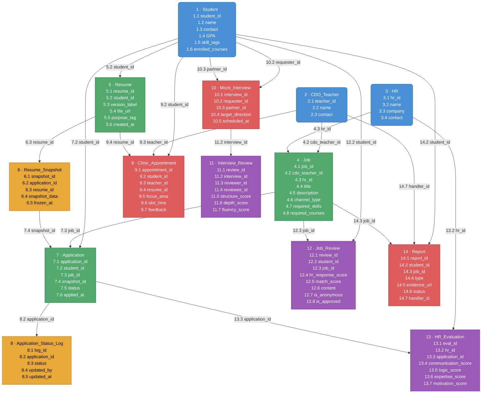

## SQL create

-- ============================================================
-- CDO 实习内推管理系统 · MySQL Schema
-- Engine: InnoDB | Charset: utf8mb4 | Collation: utf8mb4_unicode_ci
-- ============================================================

SET NAMES utf8mb4;
SET FOREIGN_KEY_CHECKS = 0;

-- ============================================================
-- SECTION 1 · 用户与角色权限
-- ============================================================

CREATE TABLE roles (
    id            TINYINT UNSIGNED NOT NULL AUTO_INCREMENT,
    role_name     VARCHAR(32)  NOT NULL COMMENT 'Student | CDO_Teacher | HR | Academic_Office',
    description   VARCHAR(128) DEFAULT NULL,
    created_at    DATETIME     NOT NULL DEFAULT CURRENT_TIMESTAMP,
    updated_at    DATETIME     NOT NULL DEFAULT CURRENT_TIMESTAMP ON UPDATE CURRENT_TIMESTAMP,
    PRIMARY KEY (id),
    UNIQUE KEY uq_role_name (role_name)
) COMMENT='角色定义表';

CREATE TABLE users (
    id            BIGINT UNSIGNED NOT NULL AUTO_INCREMENT,
    username      VARCHAR(64)  NOT NULL,
    email         VARCHAR(128) NOT NULL,
    password_hash VARCHAR(255) NOT NULL,
    display_name  VARCHAR(64)  DEFAULT NULL,
    is_active     TINYINT(1)   NOT NULL DEFAULT 1,
    last_login_at DATETIME     DEFAULT NULL,
    created_at    DATETIME     NOT NULL DEFAULT CURRENT_TIMESTAMP,
    updated_at    DATETIME     NOT NULL DEFAULT CURRENT_TIMESTAMP ON UPDATE CURRENT_TIMESTAMP,
    PRIMARY KEY (id),
    UNIQUE KEY uq_email (email),
    UNIQUE KEY uq_username (username)
) COMMENT='统一用户表，所有角色共用';

CREATE TABLE user_roles (
    id         BIGINT UNSIGNED NOT NULL AUTO_INCREMENT,
    user_id    BIGINT UNSIGNED NOT NULL,
    role_id    TINYINT UNSIGNED NOT NULL,
    granted_at DATETIME NOT NULL DEFAULT CURRENT_TIMESTAMP,
    created_at DATETIME NOT NULL DEFAULT CURRENT_TIMESTAMP,
    updated_at DATETIME NOT NULL DEFAULT CURRENT_TIMESTAMP ON UPDATE CURRENT_TIMESTAMP,
    PRIMARY KEY (id),
    UNIQUE KEY uq_user_role (user_id, role_id),
    CONSTRAINT fk_ur_user FOREIGN KEY (user_id) REFERENCES users(id) ON DELETE CASCADE,
    CONSTRAINT fk_ur_role FOREIGN KEY (role_id) REFERENCES roles(id)
) COMMENT='用户-角色多对多';

-- ============================================================
-- SECTION 2 · 学生档案
-- ============================================================

CREATE TABLE student_profiles (
    id              BIGINT UNSIGNED NOT NULL AUTO_INCREMENT,
    user_id         BIGINT UNSIGNED NOT NULL,
    student_no      VARCHAR(32)  NOT NULL COMMENT '学号',
    real_name       VARCHAR(64)  NOT NULL,
    phone           VARCHAR(20)  DEFAULT NULL COMMENT '含国际区号，仅 CDO/HR 可见',
    grade           SMALLINT     DEFAULT NULL COMMENT '入学年份，如 2022',
    major           VARCHAR(64)  DEFAULT NULL,
    gpa             DECIMAL(4,2) DEFAULT NULL,
    linkedin_url    VARCHAR(255) DEFAULT NULL,
    bio             TEXT         DEFAULT NULL,
    created_at      DATETIME     NOT NULL DEFAULT CURRENT_TIMESTAMP,
    updated_at      DATETIME     NOT NULL DEFAULT CURRENT_TIMESTAMP ON UPDATE CURRENT_TIMESTAMP,
    PRIMARY KEY (id),
    UNIQUE KEY uq_user_id (user_id),
    UNIQUE KEY uq_student_no (student_no),
    CONSTRAINT fk_sp_user FOREIGN KEY (user_id) REFERENCES users(id) ON DELETE CASCADE
) COMMENT='学生扩展档案，phone 等 PII 字段在视图层对 Academic_Office 屏蔽';

CREATE TABLE skill_tags (
    id          INT UNSIGNED NOT NULL AUTO_INCREMENT,
    tag_name    VARCHAR(64)  NOT NULL COMMENT '财务建模 | PEVC | Python | 算法 | ...',
    category    VARCHAR(32)  DEFAULT NULL COMMENT '技术 | 金融 | 语言 | 软技能',
    created_at  DATETIME     NOT NULL DEFAULT CURRENT_TIMESTAMP,
    updated_at  DATETIME     NOT NULL DEFAULT CURRENT_TIMESTAMP ON UPDATE CURRENT_TIMESTAMP,
    PRIMARY KEY (id),
    UNIQUE KEY uq_tag_name (tag_name)
) COMMENT='技能标签字典';

CREATE TABLE student_skill_tags (
    id              BIGINT UNSIGNED NOT NULL AUTO_INCREMENT,
    student_id      BIGINT UNSIGNED NOT NULL,
    skill_tag_id    INT UNSIGNED    NOT NULL,
    proficiency     TINYINT UNSIGNED DEFAULT 3 COMMENT '1-5 自评熟练度',
    created_at      DATETIME NOT NULL DEFAULT CURRENT_TIMESTAMP,
    updated_at      DATETIME NOT NULL DEFAULT CURRENT_TIMESTAMP ON UPDATE CURRENT_TIMESTAMP,
    PRIMARY KEY (id),
    UNIQUE KEY uq_student_skill (student_id, skill_tag_id),
    CONSTRAINT fk_sst_student   FOREIGN KEY (student_id)   REFERENCES student_profiles(id) ON DELETE CASCADE,
    CONSTRAINT fk_sst_skill_tag FOREIGN KEY (skill_tag_id) REFERENCES skill_tags(id)
) COMMENT='学生当前技能标签（实时，非快照）';

CREATE TABLE courses (
    id           INT UNSIGNED NOT NULL AUTO_INCREMENT,
    course_code  VARCHAR(32)  NOT NULL,
    course_name  VARCHAR(128) NOT NULL COMMENT '复旦数学分析 | Python数据分析 | ...',
    provider     VARCHAR(64)  DEFAULT NULL COMMENT '复旦大学 | Coursera | ...',
    created_at   DATETIME     NOT NULL DEFAULT CURRENT_TIMESTAMP,
    updated_at   DATETIME     NOT NULL DEFAULT CURRENT_TIMESTAMP ON UPDATE CURRENT_TIMESTAMP,
    PRIMARY KEY (id),
    UNIQUE KEY uq_course_code (course_code)
) COMMENT='课程字典';

CREATE TABLE student_courses (
    id           BIGINT UNSIGNED NOT NULL AUTO_INCREMENT,
    student_id   BIGINT UNSIGNED NOT NULL,
    course_id    INT UNSIGNED    NOT NULL,
    grade_score  VARCHAR(8)   DEFAULT NULL COMMENT '成绩，如 A / 95',
    completed_at DATE         DEFAULT NULL,
    created_at   DATETIME     NOT NULL DEFAULT CURRENT_TIMESTAMP,
    updated_at   DATETIME     NOT NULL DEFAULT CURRENT_TIMESTAMP ON UPDATE CURRENT_TIMESTAMP,
    PRIMARY KEY (id),
    UNIQUE KEY uq_student_course (student_id, course_id),
    CONSTRAINT fk_sc_student FOREIGN KEY (student_id) REFERENCES student_profiles(id) ON DELETE CASCADE,
    CONSTRAINT fk_sc_course  FOREIGN KEY (course_id)  REFERENCES courses(id)
) COMMENT='学生已修课程';

CREATE TABLE student_resumes (
    id           BIGINT UNSIGNED NOT NULL AUTO_INCREMENT,
    student_id   BIGINT UNSIGNED NOT NULL,
    version_tag  VARCHAR(32)  NOT NULL COMMENT '如 v3-秋招-金融方向',
    file_url     VARCHAR(512) NOT NULL COMMENT 'OSS/S3 路径',
    is_default   TINYINT(1)   NOT NULL DEFAULT 0 COMMENT '当前默认投递版本',
    created_at   DATETIME     NOT NULL DEFAULT CURRENT_TIMESTAMP,
    updated_at   DATETIME     NOT NULL DEFAULT CURRENT_TIMESTAMP ON UPDATE CURRENT_TIMESTAMP,
    PRIMARY KEY (id),
    KEY idx_student_id (student_id),
    CONSTRAINT fk_sr_student FOREIGN KEY (student_id) REFERENCES student_profiles(id) ON DELETE CASCADE
) COMMENT='学生简历版本库，支持多版本管理';

-- ============================================================
-- SECTION 3 · 企业与岗位
-- ============================================================

CREATE TABLE companies (
    id              INT UNSIGNED NOT NULL AUTO_INCREMENT,
    company_name    VARCHAR(128) NOT NULL,
    industry        VARCHAR(64)  DEFAULT NULL COMMENT '金融 | 咨询 | 互联网 | ...',
    company_size    VARCHAR(32)  DEFAULT NULL COMMENT '500+ | 1000+ | ...',
    website_url     VARCHAR(255) DEFAULT NULL,
    hr_contact_name VARCHAR(64)  DEFAULT NULL,
    hr_contact_email VARCHAR(128) DEFAULT NULL,
    created_at      DATETIME     NOT NULL DEFAULT CURRENT_TIMESTAMP,
    updated_at      DATETIME     NOT NULL DEFAULT CURRENT_TIMESTAMP ON UPDATE CURRENT_TIMESTAMP,
    PRIMARY KEY (id),
    KEY idx_industry (industry)
) COMMENT='企业信息表';

CREATE TABLE job_positions (
    id                  BIGINT UNSIGNED NOT NULL AUTO_INCREMENT,
    company_id          INT UNSIGNED    NOT NULL,
    posted_by_user_id   BIGINT UNSIGNED NOT NULL COMMENT '发布者（CDO老师或HR）',
    hr_user_id          BIGINT UNSIGNED DEFAULT NULL COMMENT '对接HR账号',
    position_title      VARCHAR(128) NOT NULL,
    position_category   VARCHAR(64)  DEFAULT NULL COMMENT '投行 | PE/VC | 咨询 | 数据分析 | ...',
    job_description     TEXT         DEFAULT NULL,
    location            VARCHAR(64)  DEFAULT NULL,
    headcount           TINYINT UNSIGNED DEFAULT NULL COMMENT '招募名额',
    -- 投递通道
    delivery_method     ENUM('email','external_link','cdo_proxy') NOT NULL DEFAULT 'external_link',
    delivery_email      VARCHAR(128) DEFAULT NULL,
    delivery_url        VARCHAR(512) DEFAULT NULL,
    -- 时间窗口
    open_at             DATE         DEFAULT NULL,
    close_at            DATE         DEFAULT NULL,
    position_status     ENUM('draft','open','closed','archived') NOT NULL DEFAULT 'open',
    -- CDO 内部备注（仅 CDO_Teacher 可见）
    cdo_internal_note   TEXT         DEFAULT NULL COMMENT '内推成功率、HR响应速度等主观备注',
    created_at          DATETIME     NOT NULL DEFAULT CURRENT_TIMESTAMP,
    updated_at          DATETIME     NOT NULL DEFAULT CURRENT_TIMESTAMP ON UPDATE CURRENT_TIMESTAMP,
    PRIMARY KEY (id),
    KEY idx_company_id (company_id),
    KEY idx_position_status (position_status),
    CONSTRAINT fk_jp_company    FOREIGN KEY (company_id)        REFERENCES companies(id),
    CONSTRAINT fk_jp_posted_by  FOREIGN KEY (posted_by_user_id) REFERENCES users(id),
    CONSTRAINT fk_jp_hr         FOREIGN KEY (hr_user_id)        REFERENCES users(id)
) COMMENT='岗位信息表';

CREATE TABLE job_skill_tag_requirements (
    id              BIGINT UNSIGNED NOT NULL AUTO_INCREMENT,
    job_position_id BIGINT UNSIGNED NOT NULL,
    skill_tag_id    INT UNSIGNED    NOT NULL,
    is_required     TINYINT(1)      NOT NULL DEFAULT 1 COMMENT '1=必须 0=加分项',
    created_at      DATETIME        NOT NULL DEFAULT CURRENT_TIMESTAMP,
    updated_at      DATETIME        NOT NULL DEFAULT CURRENT_TIMESTAMP ON UPDATE CURRENT_TIMESTAMP,
    PRIMARY KEY (id),
    UNIQUE KEY uq_job_skill (job_position_id, skill_tag_id),
    CONSTRAINT fk_jstr_job   FOREIGN KEY (job_position_id) REFERENCES job_positions(id) ON DELETE CASCADE,
    CONSTRAINT fk_jstr_skill FOREIGN KEY (skill_tag_id)    REFERENCES skill_tags(id)
) COMMENT='岗位所需技能标签';

CREATE TABLE job_prerequisite_courses (
    id              BIGINT UNSIGNED NOT NULL AUTO_INCREMENT,
    job_position_id BIGINT UNSIGNED NOT NULL,
    course_id       INT UNSIGNED    NOT NULL,
    is_required     TINYINT(1)      NOT NULL DEFAULT 0 COMMENT '1=硬性前置 0=推荐',
    created_at      DATETIME        NOT NULL DEFAULT CURRENT_TIMESTAMP,
    updated_at      DATETIME        NOT NULL DEFAULT CURRENT_TIMESTAMP ON UPDATE CURRENT_TIMESTAMP,
    PRIMARY KEY (id),
    UNIQUE KEY uq_job_course (job_position_id, course_id),
    CONSTRAINT fk_jpc_job    FOREIGN KEY (job_position_id) REFERENCES job_positions(id) ON DELETE CASCADE,
    CONSTRAINT fk_jpc_course FOREIGN KEY (course_id)       REFERENCES courses(id)
) COMMENT='岗位前置课程要求';

-- ============================================================
-- SECTION 4 · 申请流水 + 简历快照（核心防篡改设计）
-- ============================================================

CREATE TABLE job_applications (
    id                  BIGINT UNSIGNED NOT NULL AUTO_INCREMENT,
    student_id          BIGINT UNSIGNED NOT NULL,
    job_position_id     BIGINT UNSIGNED NOT NULL,
    -- 投递时使用的简历版本（外键保留溯源，快照表保留内容）
    resume_version_id   BIGINT UNSIGNED NOT NULL COMMENT '投递时选用的简历版本',
    application_status  ENUM(
        'submitted',        -- 已投递
        'resume_screening', -- 简历初筛中
        'written_test',     -- 笔试
        'interview_r1',     -- 一面
        'interview_r2',     -- 二面
        'final_interview',  -- 终面
        'offer_received',   -- 已获 Offer
        'onboarded',        -- 已入职
        'rejected',         -- 不匹配/淘汰
        'talent_pool',      -- 人才库储备
        'withdrawn'         -- 学生主动撤回
    ) NOT NULL DEFAULT 'submitted',
    is_referral         TINYINT(1)   NOT NULL DEFAULT 0 COMMENT '是否走内推通道',
    referral_note       VARCHAR(255) DEFAULT NULL COMMENT '内推人/渠道备注',
    student_note        TEXT         DEFAULT NULL COMMENT '学生投递备注',
    applied_at          DATETIME     NOT NULL DEFAULT CURRENT_TIMESTAMP,
    created_at          DATETIME     NOT NULL DEFAULT CURRENT_TIMESTAMP,
    updated_at          DATETIME     NOT NULL DEFAULT CURRENT_TIMESTAMP ON UPDATE CURRENT_TIMESTAMP,
    PRIMARY KEY (id),
    UNIQUE KEY uq_student_job (student_id, job_position_id) COMMENT '同一岗位不重复投递',
    KEY idx_application_status (application_status),
    CONSTRAINT fk_ja_student   FOREIGN KEY (student_id)        REFERENCES student_profiles(id),
    CONSTRAINT fk_ja_job       FOREIGN KEY (job_position_id)   REFERENCES job_positions(id),
    CONSTRAINT fk_ja_resume    FOREIGN KEY (resume_version_id) REFERENCES student_resumes(id)
) COMMENT='申请主表，投递行为记录';

-- 简历内容快照：投递瞬间的简历文件 + 核心字段冻结
CREATE TABLE application_resume_snapshots (
    id                  BIGINT UNSIGNED NOT NULL AUTO_INCREMENT,
    application_id      BIGINT UNSIGNED NOT NULL,
    -- 冻结的简历文件
    resume_file_url     VARCHAR(512) NOT NULL COMMENT '投递时的简历 OSS 路径副本',
    resume_version_tag  VARCHAR(32)  DEFAULT NULL,
    -- 冻结的学生关键信息（防止学生事后修改档案影响历史记录）
    snapshot_student_name  VARCHAR(64)  NOT NULL,
    snapshot_gpa           DECIMAL(4,2) DEFAULT NULL,
    snapshot_major         VARCHAR(64)  DEFAULT NULL,
    snapshot_grade         SMALLINT     DEFAULT NULL,
    snapshot_bio           TEXT         DEFAULT NULL,
    snapshotted_at         DATETIME     NOT NULL DEFAULT CURRENT_TIMESTAMP,
    created_at             DATETIME     NOT NULL DEFAULT CURRENT_TIMESTAMP,
    updated_at             DATETIME     NOT NULL DEFAULT CURRENT_TIMESTAMP ON UPDATE CURRENT_TIMESTAMP,
    PRIMARY KEY (id),
    UNIQUE KEY uq_application_id (application_id),
    CONSTRAINT fk_ars_application FOREIGN KEY (application_id) REFERENCES job_applications(id) ON DELETE CASCADE
) COMMENT='简历内容快照，投递后不可变更';

-- 技能标签快照：投递瞬间的技能集合冻结
CREATE TABLE application_skill_tag_snapshots (
    id              BIGINT UNSIGNED NOT NULL AUTO_INCREMENT,
    application_id  BIGINT UNSIGNED NOT NULL,
    skill_tag_id    INT UNSIGNED    NOT NULL,
    tag_name        VARCHAR(64)     NOT NULL COMMENT '冗余存储标签名，防字典变更影响历史',
    proficiency     TINYINT UNSIGNED DEFAULT NULL,
    created_at      DATETIME        NOT NULL DEFAULT CURRENT_TIMESTAMP,
    updated_at      DATETIME        NOT NULL DEFAULT CURRENT_TIMESTAMP ON UPDATE CURRENT_TIMESTAMP,
    PRIMARY KEY (id),
    KEY idx_application_id (application_id),
    CONSTRAINT fk_asts_application FOREIGN KEY (application_id) REFERENCES job_applications(id) ON DELETE CASCADE
) COMMENT='技能标签快照，与申请绑定，独立于学生实时标签';

-- 申请状态流转日志（完整状态机轨迹）
CREATE TABLE application_status_logs (
    id              BIGINT UNSIGNED NOT NULL AUTO_INCREMENT,
    application_id  BIGINT UNSIGNED NOT NULL,
    from_status     VARCHAR(32)  DEFAULT NULL COMMENT 'NULL 表示初始状态',
    to_status       VARCHAR(32)  NOT NULL,
    changed_by_user_id BIGINT UNSIGNED NOT NULL,
    change_reason   VARCHAR(255) DEFAULT NULL,
    changed_at      DATETIME     NOT NULL DEFAULT CURRENT_TIMESTAMP,
    created_at      DATETIME     NOT NULL DEFAULT CURRENT_TIMESTAMP,
    updated_at      DATETIME     NOT NULL DEFAULT CURRENT_TIMESTAMP ON UPDATE CURRENT_TIMESTAMP,
    PRIMARY KEY (id),
    KEY idx_application_id (application_id),
    CONSTRAINT fk_asl_application FOREIGN KEY (application_id)    REFERENCES job_applications(id) ON DELETE CASCADE,
    CONSTRAINT fk_asl_changed_by  FOREIGN KEY (changed_by_user_id) REFERENCES users(id)
) COMMENT='申请状态机完整流转日志，不可删除';

-- ============================================================
-- SECTION 5 · 多维反馈体系
-- ============================================================

-- 5a. 学生对岗位/公司的评价（支持匿名）
CREATE TABLE student_job_reviews (
    id                  BIGINT UNSIGNED NOT NULL AUTO_INCREMENT,
    application_id      BIGINT UNSIGNED NOT NULL COMMENT '必须有过申请才能评价',
    is_anonymous        TINYINT(1)      NOT NULL DEFAULT 0,
    -- 结构化评分 1-5
    rating_overall      TINYINT UNSIGNED DEFAULT NULL COMMENT '综合评分',
    rating_hr_response  TINYINT UNSIGNED DEFAULT NULL COMMENT 'HR响应速度',
    rating_job_match    TINYINT UNSIGNED DEFAULT NULL COMMENT '岗位与描述匹配度',
    rating_culture      TINYINT UNSIGNED DEFAULT NULL COMMENT '企业文化',
    -- 面经内容
    interview_experience TEXT         DEFAULT NULL COMMENT '面经正文',
    interview_questions  TEXT         DEFAULT NULL COMMENT '真题记录（JSON 或纯文本）',
    review_status        ENUM('pending_review','approved','rejected') NOT NULL DEFAULT 'pending_review'
                         COMMENT 'CDO 审核后才公开',
    created_at           DATETIME     NOT NULL DEFAULT CURRENT_TIMESTAMP,
    updated_at           DATETIME     NOT NULL DEFAULT CURRENT_TIMESTAMP ON UPDATE CURRENT_TIMESTAMP,
    PRIMARY KEY (id),
    KEY idx_application_id (application_id),
    CONSTRAINT fk_sjr_application FOREIGN KEY (application_id) REFERENCES job_applications(id)
) COMMENT='学生对岗位的评价与面经，支持匿名';

-- 5b. HR 对学生面试表现的结构化评价
CREATE TABLE hr_interview_evaluations (
    id                  BIGINT UNSIGNED NOT NULL AUTO_INCREMENT,
    application_id      BIGINT UNSIGNED NOT NULL,
    evaluator_user_id   BIGINT UNSIGNED NOT NULL COMMENT 'HR 账号',
    interview_round     TINYINT UNSIGNED NOT NULL DEFAULT 1 COMMENT '第几轮面试',
    -- 结构化评分维度 1-5
    score_communication TINYINT UNSIGNED DEFAULT NULL COMMENT '沟通表达',
    score_logic         TINYINT UNSIGNED DEFAULT NULL COMMENT '逻辑思维',
    score_domain        TINYINT UNSIGNED DEFAULT NULL COMMENT '专业知识',
    score_motivation    TINYINT UNSIGNED DEFAULT NULL COMMENT '求职动机匹配度',
    score_overall       TINYINT UNSIGNED DEFAULT NULL COMMENT '综合评分',
    strengths           TEXT         DEFAULT NULL,
    weaknesses          TEXT         DEFAULT NULL,
    recommendation      ENUM('strong_yes','yes','maybe','no') DEFAULT NULL,
    evaluated_at        DATETIME     NOT NULL DEFAULT CURRENT_TIMESTAMP,
    created_at          DATETIME     NOT NULL DEFAULT CURRENT_TIMESTAMP,
    updated_at          DATETIME     NOT NULL DEFAULT CURRENT_TIMESTAMP ON UPDATE CURRENT_TIMESTAMP,
    PRIMARY KEY (id),
    KEY idx_application_id (application_id),
    CONSTRAINT fk_hie_application FOREIGN KEY (application_id)  REFERENCES job_applications(id),
    CONSTRAINT fk_hie_evaluator   FOREIGN KEY (evaluator_user_id) REFERENCES users(id)
) COMMENT='HR 对学生面试表现的结构化评价，仅 CDO/HR 可见';

-- 5c. CDO 老师对岗位的内部复盘备注
CREATE TABLE cdo_position_notes (
    id                  BIGINT UNSIGNED NOT NULL AUTO_INCREMENT,
    job_position_id     BIGINT UNSIGNED NOT NULL,
    author_user_id      BIGINT UNSIGNED NOT NULL COMMENT 'CDO_Teacher',
    note_type           ENUM('referral_rate','hr_quality','job_quality','risk_flag','general')
                        NOT NULL DEFAULT 'general',
    note_content        TEXT         NOT NULL,
    is_pinned           TINYINT(1)   NOT NULL DEFAULT 0,
    created_at          DATETIME     NOT NULL DEFAULT CURRENT_TIMESTAMP,
    updated_at          DATETIME     NOT NULL DEFAULT CURRENT_TIMESTAMP ON UPDATE CURRENT_TIMESTAMP,
    PRIMARY KEY (id),
    KEY idx_job_position_id (job_position_id),
    CONSTRAINT fk_cpn_job    FOREIGN KEY (job_position_id) REFERENCES job_positions(id) ON DELETE CASCADE,
    CONSTRAINT fk_cpn_author FOREIGN KEY (author_user_id)  REFERENCES users(id)
) COMMENT='CDO 老师内部复盘备注，仅 CDO_Teacher 角色可读写';

-- ============================================================
-- SECTION 6 · 简历门诊
-- ============================================================

CREATE TABLE clinic_slots (
    id              BIGINT UNSIGNED NOT NULL AUTO_INCREMENT,
    teacher_user_id BIGINT UNSIGNED NOT NULL COMMENT 'CDO 老师',
    slot_date       DATE         NOT NULL,
    slot_start_at   TIME         NOT NULL,
    slot_end_at     TIME         NOT NULL,
    total_quota     TINYINT UNSIGNED NOT NULL DEFAULT 1,
    remaining_quota TINYINT UNSIGNED NOT NULL DEFAULT 1,
    location        VARCHAR(128) DEFAULT NULL COMMENT '线下地点或腾讯会议链接',
    slot_status     ENUM('open','full','cancelled') NOT NULL DEFAULT 'open',
    created_at      DATETIME     NOT NULL DEFAULT CURRENT_TIMESTAMP,
    updated_at      DATETIME     NOT NULL DEFAULT CURRENT_TIMESTAMP ON UPDATE CURRENT_TIMESTAMP,
    PRIMARY KEY (id),
    KEY idx_slot_date (slot_date),
    KEY idx_teacher_user_id (teacher_user_id),
    CONSTRAINT fk_cs_teacher FOREIGN KEY (teacher_user_id) REFERENCES users(id)
) COMMENT='简历门诊名额释放表';

CREATE TABLE clinic_appointments (
    id              BIGINT UNSIGNED NOT NULL AUTO_INCREMENT,
    slot_id         BIGINT UNSIGNED NOT NULL,
    student_id      BIGINT UNSIGNED NOT NULL,
    resume_id       BIGINT UNSIGNED DEFAULT NULL COMMENT '预约时指定的简历版本',
    student_note    VARCHAR(512) DEFAULT NULL COMMENT '学生希望重点修改的方向',
        appointment_status ENUM('pending','confirmed','completed','cancelled','no_show')
                        NOT NULL DEFAULT 'pending',
    feedback_note       TEXT         DEFAULT NULL COMMENT 'CDO 老师门诊后反馈',
    created_at          DATETIME     NOT NULL DEFAULT CURRENT_TIMESTAMP,
    updated_at          DATETIME     NOT NULL DEFAULT CURRENT_TIMESTAMP ON UPDATE CURRENT_TIMESTAMP,
    PRIMARY KEY (id),
    UNIQUE KEY uq_slot_student (slot_id, student_id),
    KEY idx_student_id (student_id),
    CONSTRAINT fk_ca_slot    FOREIGN KEY (slot_id)    REFERENCES clinic_slots(id),
    CONSTRAINT fk_ca_student FOREIGN KEY (student_id) REFERENCES student_profiles(id),
    CONSTRAINT fk_ca_resume  FOREIGN KEY (resume_id)  REFERENCES student_resumes(id)
) COMMENT='简历门诊预约记录';

-- ============================================================
-- SECTION 7 · Mock 面试（同伴匹配）
-- ============================================================

CREATE TABLE mock_interview_sessions (
    id                  BIGINT UNSIGNED NOT NULL AUTO_INCREMENT,
    initiator_student_id BIGINT UNSIGNED NOT NULL COMMENT '发起方',
    partner_student_id   BIGINT UNSIGNED DEFAULT NULL COMMENT '匹配到的搭档，NULL 表示待匹配',
    target_position_id   BIGINT UNSIGNED DEFAULT NULL COMMENT '模拟的目标岗位（可选）',
    scheduled_at         DATETIME     DEFAULT NULL,
    duration_minutes     SMALLINT UNSIGNED DEFAULT 60,
    location             VARCHAR(128) DEFAULT NULL,
    session_status       ENUM('waiting_match','matched','completed','cancelled')
                         NOT NULL DEFAULT 'waiting_match',
    focus_areas          VARCHAR(255) DEFAULT NULL COMMENT '重点练习方向，如：案例分析/行为面试',
    created_at           DATETIME     NOT NULL DEFAULT CURRENT_TIMESTAMP,
    updated_at           DATETIME     NOT NULL DEFAULT CURRENT_TIMESTAMP ON UPDATE CURRENT_TIMESTAMP,
    PRIMARY KEY (id),
    KEY idx_initiator (initiator_student_id),
    KEY idx_partner (partner_student_id),
    CONSTRAINT fk_mis_initiator FOREIGN KEY (initiator_student_id) REFERENCES student_profiles(id),
    CONSTRAINT fk_mis_partner   FOREIGN KEY (partner_student_id)   REFERENCES student_profiles(id),
    CONSTRAINT fk_mis_position  FOREIGN KEY (target_position_id)   REFERENCES job_positions(id)
) COMMENT='Mock 面试场次，支持同伴匹配';

-- 双向互评：A 评 B，B 评 A，各自独立一行
CREATE TABLE mock_interview_peer_reviews (
    id              BIGINT UNSIGNED NOT NULL AUTO_INCREMENT,
    session_id      BIGINT UNSIGNED NOT NULL,
    reviewer_id     BIGINT UNSIGNED NOT NULL COMMENT '评价方学生',
    reviewee_id     BIGINT UNSIGNED NOT NULL COMMENT '被评价方学生',
    score_structure TINYINT UNSIGNED DEFAULT NULL COMMENT '回答结构性 1-5',
    score_content   TINYINT UNSIGNED DEFAULT NULL COMMENT '内容深度 1-5',
    score_delivery  TINYINT UNSIGNED DEFAULT NULL COMMENT '表达流畅度 1-5',
    score_overall   TINYINT UNSIGNED DEFAULT NULL,
    comments        TEXT         DEFAULT NULL,
    created_at      DATETIME     NOT NULL DEFAULT CURRENT_TIMESTAMP,
    updated_at      DATETIME     NOT NULL DEFAULT CURRENT_TIMESTAMP ON UPDATE CURRENT_TIMESTAMP,
    PRIMARY KEY (id),
    UNIQUE KEY uq_session_reviewer_reviewee (session_id, reviewer_id, reviewee_id),
    CONSTRAINT fk_mipr_session  FOREIGN KEY (session_id)  REFERENCES mock_interview_sessions(id) ON DELETE CASCADE,
    CONSTRAINT fk_mipr_reviewer FOREIGN KEY (reviewer_id) REFERENCES student_profiles(id),
    CONSTRAINT fk_mipr_reviewee FOREIGN KEY (reviewee_id) REFERENCES student_profiles(id)
) COMMENT='Mock 面试双向互评';

-- ============================================================
-- SECTION 8 · 真题练习记录
-- ============================================================

CREATE TABLE practice_questions (
    id              INT UNSIGNED NOT NULL AUTO_INCREMENT,
    source_company  VARCHAR(128) DEFAULT NULL COMMENT '题目来源企业',
    question_type   ENUM('behavioral','case','technical','written_test') NOT NULL,
    question_text   TEXT         NOT NULL,
    reference_answer TEXT        DEFAULT NULL,
    skill_tag_id    INT UNSIGNED DEFAULT NULL COMMENT '关联技能标签',
    difficulty      TINYINT UNSIGNED DEFAULT 3 COMMENT '1-5',
    contributed_by  BIGINT UNSIGNED DEFAULT NULL COMMENT '贡献题目的学生 user_id',
    is_verified     TINYINT(1)   NOT NULL DEFAULT 0 COMMENT 'CDO 审核通过',
    created_at      DATETIME     NOT NULL DEFAULT CURRENT_TIMESTAMP,
    updated_at      DATETIME     NOT NULL DEFAULT CURRENT_TIMESTAMP ON UPDATE CURRENT_TIMESTAMP,
    PRIMARY KEY (id),
    KEY idx_question_type (question_type),
    CONSTRAINT fk_pq_skill_tag    FOREIGN KEY (skill_tag_id)  REFERENCES skill_tags(id),
    CONSTRAINT fk_pq_contributed  FOREIGN KEY (contributed_by) REFERENCES users(id)
) COMMENT='真题题库，学生可贡献，CDO 审核';

CREATE TABLE student_practice_logs (
    id              BIGINT UNSIGNED NOT NULL AUTO_INCREMENT,
    student_id      BIGINT UNSIGNED NOT NULL,
    question_id     INT UNSIGNED    NOT NULL,
    student_answer  TEXT         DEFAULT NULL,
    self_score      TINYINT UNSIGNED DEFAULT NULL COMMENT '自评 1-5',
    practiced_at    DATETIME     NOT NULL DEFAULT CURRENT_TIMESTAMP,
    created_at      DATETIME     NOT NULL DEFAULT CURRENT_TIMESTAMP,
    updated_at      DATETIME     NOT NULL DEFAULT CURRENT_TIMESTAMP ON UPDATE CURRENT_TIMESTAMP,
    PRIMARY KEY (id),
    KEY idx_student_id (student_id),
    CONSTRAINT fk_spl_student  FOREIGN KEY (student_id)  REFERENCES student_profiles(id) ON DELETE CASCADE,
    CONSTRAINT fk_spl_question FOREIGN KEY (question_id) REFERENCES practice_questions(id)
) COMMENT='学生真题练习记录';

-- ============================================================
-- SECTION 9 · 教务处审计视图（权限隔离）
-- ============================================================

-- 教务处只能看到脱敏的统计数据，视图层屏蔽所有 PII
CREATE OR REPLACE VIEW v_academic_office_stats AS
SELECT
    jp.id                                        AS job_position_id,
    c.company_name,
    jp.position_title,
    jp.position_category,
    COUNT(ja.id)                                 AS total_applications,
    SUM(ja.is_referral)                          AS referral_count,
    SUM(ja.application_status = 'offer_received') AS offer_count,
    SUM(ja.application_status = 'onboarded')     AS onboarded_count,
    SUM(ja.application_status = 'rejected')      AS rejected_count,
    jp.open_at,
    jp.close_at
FROM job_positions jp
JOIN companies c         ON c.id = jp.company_id
LEFT JOIN job_applications ja ON ja.job_position_id = jp.id
GROUP BY jp.id, c.company_name, jp.position_title, jp.position_category, jp.open_at, jp.close_at;

-- CDO 决策视图：汇总内推质量指标（含 cdo_internal_note，仅 CDO 角色查询）
CREATE OR REPLACE VIEW v_cdo_position_dashboard AS
SELECT
    jp.id                                         AS job_position_id,
    c.company_name,
    jp.position_title,
    jp.position_category,
    jp.delivery_method,
    jp.position_status,
    jp.cdo_internal_note,
    COUNT(ja.id)                                  AS total_applications,
    ROUND(AVG(sjr.rating_overall), 2)             AS avg_student_rating,
    ROUND(AVG(sjr.rating_hr_response), 2)         AS avg_hr_response_rating,
    SUM(ja.application_status = 'offer_received') AS offer_count,
    jp.open_at,
    jp.close_at
FROM job_positions jp
JOIN companies c              ON c.id = jp.company_id
LEFT JOIN job_applications ja ON ja.job_position_id = jp.id
LEFT JOIN student_job_reviews sjr ON sjr.application_id = ja.id
                                  AND sjr.review_status = 'approved'
GROUP BY jp.id, c.company_name, jp.position_title, jp.position_category,
         jp.delivery_method, jp.position_status, jp.cdo_internal_note,
         jp.open_at, jp.close_at;

SET FOREIGN_KEY_CHECKS = 1;

## MERMAID pose

下面分两层输出，每层一个独立的 Mermaid 代码块，可直接粘入 Typora 渲染。

---

**第一层：全表关系数据流图**

---

**第二层：各表内部数据流图**

```mermaid
flowchart TD
    classDef fieldNode fill:#D6EAF8,stroke:#2E86C1,color:#000
    classDef pkNode fill:#2E86C1,stroke:#1A5276,color:#fff
    classDef fkNode fill:#A9CCE3,stroke:#2E86C1,color:#000
    classDef outNode fill:#52A96E,stroke:#2E6B45,color:#fff

    subgraph T1["1 · Student"]
        S1_1(["1.1 student_id 🔑"])
        S1_2["1.2 name"]
        S1_3["1.3 contact"]
        S1_4["1.4 GPA"]
        S1_5["1.5 skill_tags"]
        S1_6["1.6 enrolled_courses"]
        S1_1 --> S1_2 & S1_3 & S1_4 & S1_5 & S1_6
    end

    subgraph T2["2 · CDO_Teacher"]
        S2_1(["2.1 teacher_id 🔑"])
        S2_2["2.2 name"]
        S2_3["2.3 contact"]
        S2_1 --> S2_2 & S2_3
    end

    subgraph T3["3 · HR"]
        S3_1(["3.1 hr_id 🔑"])
        S3_2["3.2 name"]
        S3_3["3.3 company"]
        S3_4["3.4 contact"]
        S3_1 --> S3_2 & S3_3 & S3_4
    end

    subgraph T4["4 · Job"]
        S4_1(["4.1 job_id 🔑"])
        S4_2(["4.2 cdo_teacher_id 🔗"])
        S4_3(["4.3 hr_id 🔗"])
        S4_4["4.4 title"]
        S4_5["4.5 description"]
        S4_6["4.6 channel_type"]
        S4_7["4.7 required_skills"]
        S4_8["4.8 required_courses"]
        S4_1 --> S4_4 & S4_5 & S4_6 & S4_7 & S4_8
        S4_2 -.->|"来自 T2"| S4_1
        S4_3 -.->|"来自 T3"| S4_1
    end

    subgraph T5["5 · Resume"]
        S5_1(["5.1 resume_id 🔑"])
        S5_2(["5.2 student_id 🔗"])
        S5_3["5.3 version_label"]
        S5_4["5.4 file_url"]
        S5_5["5.5 purpose_tag"]
        S5_6["5.6 created_at"]
        S5_2 -.->|"来自 T1"| S5_1
        S5_1 --> S5_3 & S5_4 & S5_5 & S5_6
    end

    subgraph T6["6 · Resume_Snapshot"]
        S6_1(["6.1 snapshot_id 🔑"])
        S6_2(["6.2 application_id 🔗"])
        S6_3(["6.3 resume_id 🔗"])
        S6_4["6.4 snapshot_data"]
        S6_5["6.5 frozen_at"]
        S6_3 -.->|"来自 T5"| S6_1
        S6_2 -.->|"来自 T7"| S6_1
        S6_1 --> S6_4 & S6_5
    end

    subgraph T7["7 · Application"]
        S7_1(["7.1 application_id 🔑"])
        S7_2(["7.2 student_id 🔗"])
        S7_3(["7.3 job_id 🔗"])
        S7_4(["7.4 snapshot_id 🔗"])
        S7_5["7.5 status"]
        S7_6["7.6 applied_at"]
        S7_2 -.->|"来自 T1"| S7_1
        S7_3 -.->|"来自 T4"| S7_1
        S7_4 -.->|"来自 T6"| S7_1
        S7_1 --> S7_5 & S7_6
    end

    subgraph T8["8 · Application_Status_Log"]
        S8_1(["8.1 log_id 🔑"])
        S8_2(["8.2 application_id 🔗"])
        S8_3["8.3 status"]
        S8_4["8.4 updated_by"]
        S8_5["8.5 updated_at"]
        S8_2 -.->|"来自 T7"| S8_1
        S8_1 --> S8_3 & S8_4 & S8_5
    end

    subgraph T9["9 · Clinic_Appointment"]
        S9_1(["9.1 appointment_id 🔑"])
        S9_2(["9.2 student_id 🔗"])
        S9_3(["9.3 teacher_id 🔗"])
        S9_4(["9.4 resume_id 🔗"])
        S9_5["9.5 focus_area"]
        S9_6["9.6 slot_time"]
        S9_7["9.7 feedback"]
        S9_2 -.->|"来自 T1"| S9_1
        S9_3 -.->|"来自 T2"| S9_1
        S9_4 -.->|"来自 T5"| S9_1
        S9_1 --> S9_5 & S9_6 & S9_7
    end

    subgraph T10["10 · Mock_Interview"]
        S10_1(["10.1 interview_id 🔑"])
        S10_2(["10.2 requester_id 🔗"])
        S10_3(["10.3 partner_id 🔗"])
        S10_4["10.4 target_direction"]
        S10_5["10.5 scheduled_at"]
        S10_2 -.->|"来自 T1"| S10_1
        S10_3 -.->|"来自 T1"| S10_1
        S10_1 --> S10_4 & S10_5
    end

    subgraph T11["11 · Interview_Review"]
        S11_1(["11.1 review_id 🔑"])
        S11_2(["11.2 interview_id 🔗"])
        S11_3(["11.3 reviewer_id 🔗"])
        S11_4(["11.4 reviewee_id 🔗"])
        S11_5["11.5 structure_score"]
        S11_6["11.6 depth_score"]
        S11_7["11.7 fluency_score"]
        S11_2 -.->|"来自 T10"| S11_1
        S11_3 -.->|"来自 T1"| S11_1
        S11_4 -.->|"来自 T1"| S11_1
        S11_1 --> S11_5 & S11_6 & S11_7
    end

    subgraph T12["12 · Job_Review"]
        S12_1(["12.1 review_id 🔑"])
        S12_2(["12.2 student_id 🔗"])
        S12_3(["12.3 job_id 🔗"])
        S12_4["12.4 hr_response_score"]
        S12_5["12.5 match_score"]
        S12_6["12.6 content"]
        S12_7["12.7 is_anonymous"]
        S12_8["12.8 is_approved"]
        S12_2 -.->|"来自 T1"| S12_1
        S12_3 -.->|"来自 T4"| S12_1
        S12_1 --> S12_4 & S12_5 & S12_6 & S12_7 & S12_8
    end

    subgraph T13["13 · HR_Evaluation"]
        S13_1(["13.1 eval_id 🔑"])
        S13_2(["13.2 hr_id 🔗"])
        S13_3(["13.3 application_id 🔗"])
        S13_4["13.4 communication_score"]
        S13_5["13.5 logic_score"]
        S13_6["13.6 expertise_score"]
        S13_7["13.7 motivation_score"]
        S13_2 -.->|"来自 T3"| S13_1
        S13_3 -.->|"来自 T7"| S13_1
        S13_1 --> S13_4 & S13_5 & S13_6 & S13_7
    end

    subgraph T14["14 · Report"]
        S14_1(["14.1 report_id 🔑"])
        S14_2(["14.2 student_id 🔗"])
        S14_3(["14.3 job_id 🔗"])
        S14_4["14.4 type"]
        S14_5["14.5 evidence_url"]
        S14_6["14.6 status"]
        S14_7(["14.7 handler_id 🔗"])
        S14_2 -.->|"来自 T1"| S14_1
        S14_3 -.->|"来自 T4"| S14_1
        S14_7 -.->|"来自 T2"| S14_1
        S14_1 --> S14_4 & S14_5 & S14_6
    end

    class S1_1,S2_1,S3_1,S4_1,S5_1,S6_1,S7_1,S8_1,S9_1,S10_1,S11_1,S12_1,S13_1,S14_1 pkNode
    class S4_2,S4_3,S5_2,S6_2,S6_3,S7_2,S7_3,S7_4,S8_2,S9_2,S9_3,S9_4,S10_2,S10_3,S11_2,S11_3,S11_4,S12_2,S12_3,S13_2,S13_3,S14_2,S14_3,S14_7 fkNode
```

---

颜色说明：

- 蓝色实心圆角 = 主键（PK）
- 浅蓝色 = 外键（FK），虚线箭头表示跨表引用来源
- 第一层中：深蓝 = 用户表，绿色 = 核心业务表，橙色 = 快照/日志表，紫色 = 评价表，红色 = 预约/举报表

