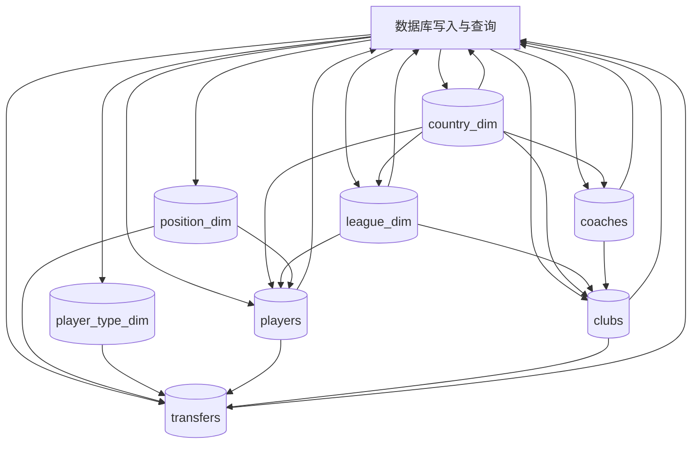
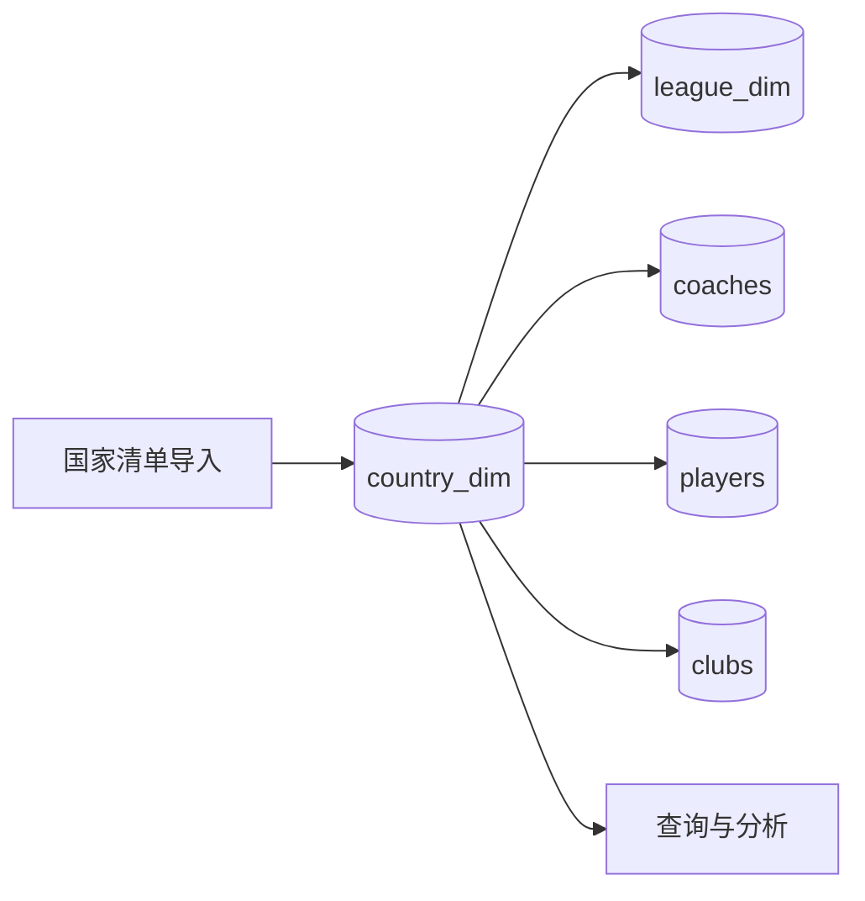
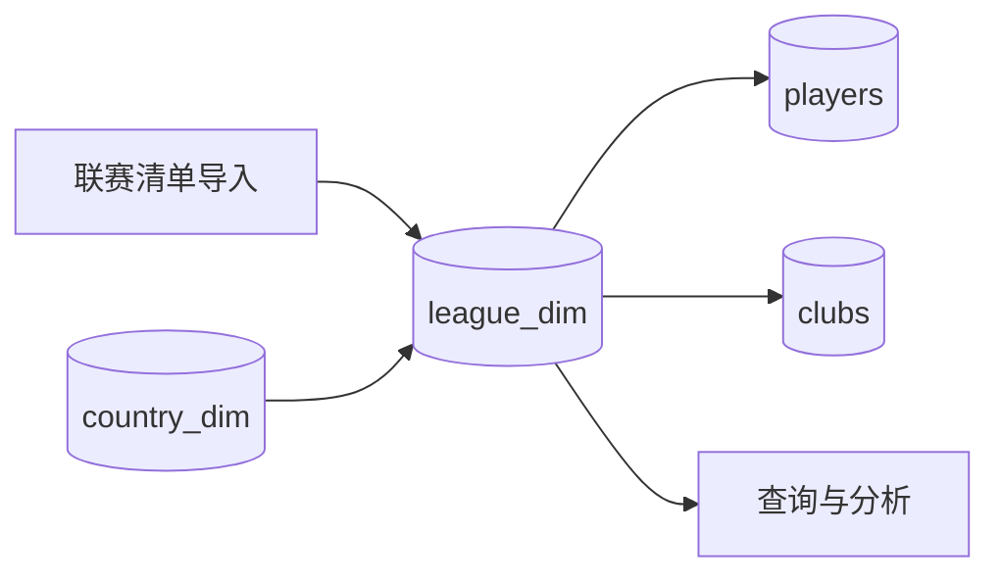
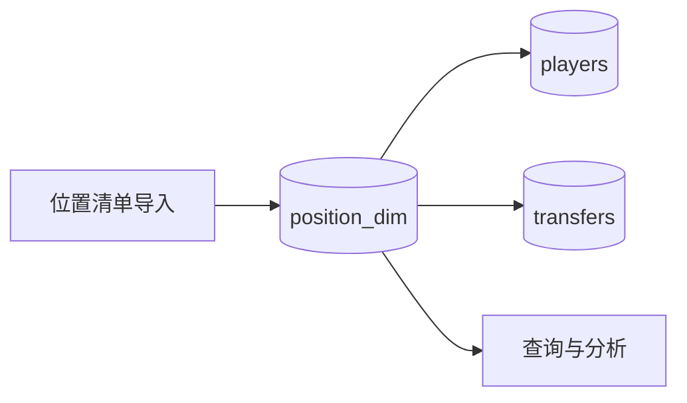
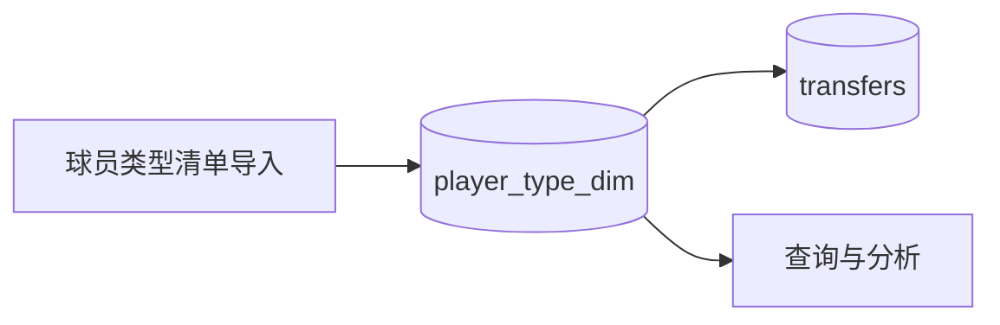
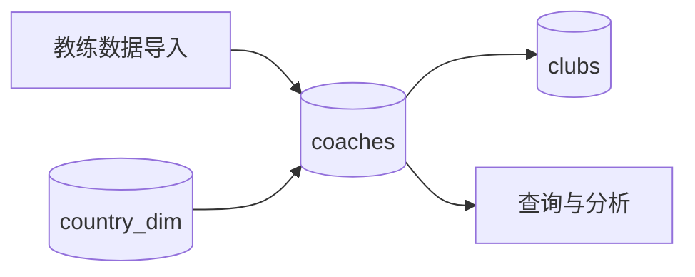
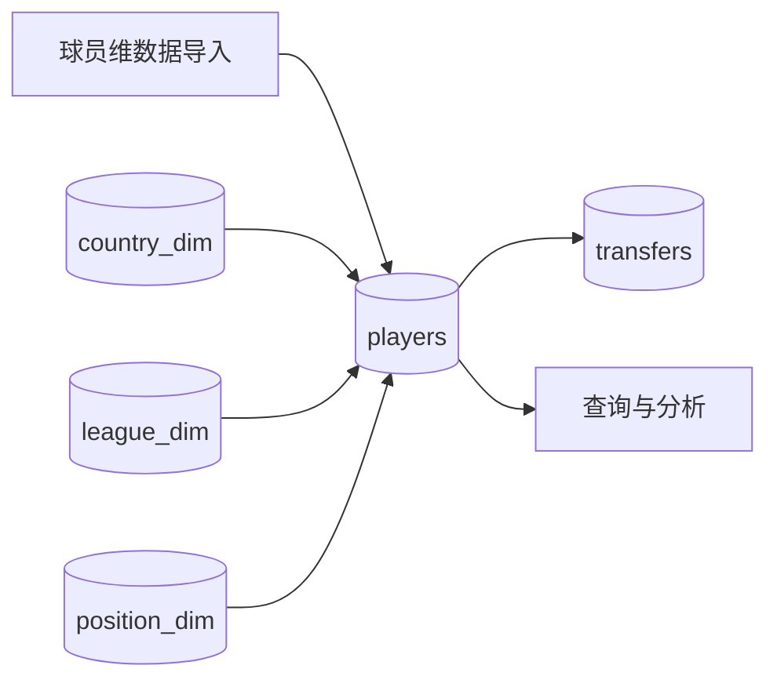
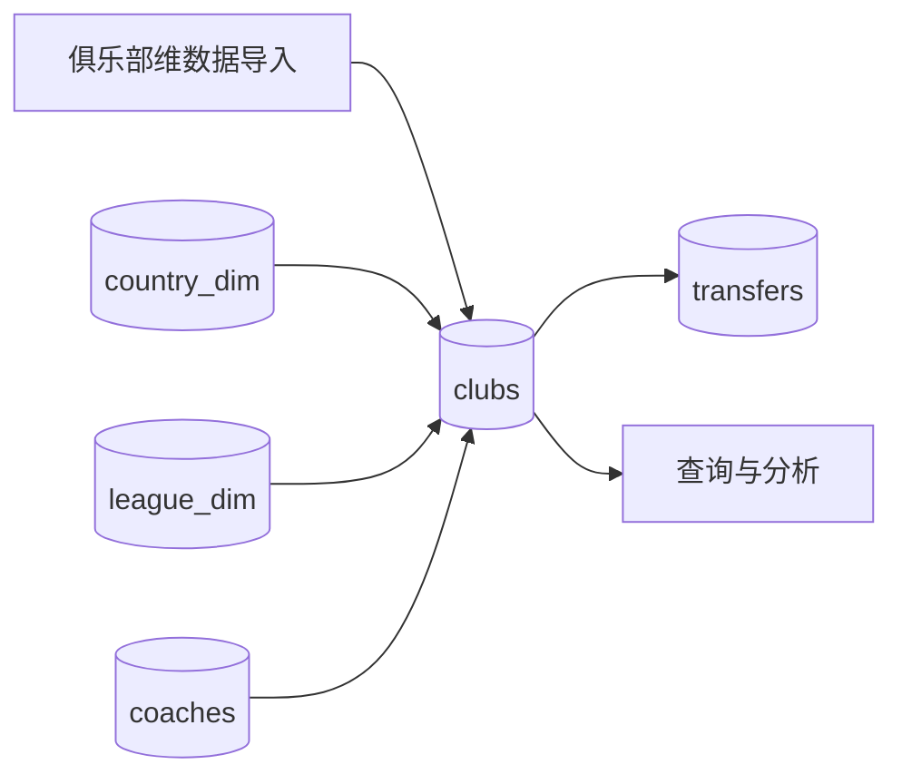
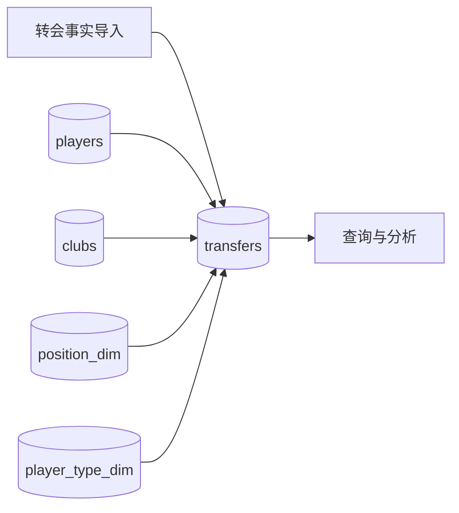

# 数据流图

本文档基于当前最终数据库结构绘制数据流图。这里的“最终结构”指执行以下两份 SQL 后的数据库：

1. `简化数据库.sql`
2. `去冗余字段.sql`

第一层数据流图描述整体数据库的数据流。第二层数据流图按表拆开，分别说明每一张表与其他表之间的数据依赖和流向。

## 第一层：整体数据流图

## 第二层：各表数据流图

### 1. `country_dim`

说明：

- `country_dim` 是国家主字典
- `league_dim` 通过 `country_dim_id` 指向国家
- `coaches`、`players`、`clubs` 都通过国家编号引用它

### 2. `league_dim`

说明：

- `league_dim` 自身依赖 `country_dim`
- `players` 中的所属联赛和 `clubs` 中的所属联赛都来自这张表

### 3. `position_dim`

说明：

- `position_dim` 统一管理位置枚举
- `players` 和 `transfers` 都通过 `position_dim_id` 引用它

### 4. `player_type_dim`

说明：

- `player_type_dim` 是转会球员类别字典
- 当前最终结构中主要被 `transfers` 使用

### 5. `coaches`

说明：

- `coaches` 通过 `nationality_country_dim_id` 连接 `country_dim`
- `clubs` 通过 `coach_id` 指向教练

### 6. `players`

说明：

- `players` 依赖国家、联赛、位置三类维表
- `transfers` 通过 `player_key` 引用球员
- 球员姓名等展示属性通过 `players` 供查询读取

### 7. `clubs`

说明：

- `clubs` 依赖国家、联赛、教练三类上游表
- `transfers` 通过 `origin_club_key` 和 `destination_club_key` 两次引用 `clubs`
- 转会中的国家和联赛信息在最终结构中应通过 `clubs` 再向上 join 取得

### 8. `transfers`

说明：

- `transfers` 是中心事实表
- 它依赖 `players`、`clubs`、`position_dim`、`player_type_dim`
- 转出俱乐部与转入俱乐部都来自 `clubs`
- 国家、联赛、球员名称、俱乐部名称等冗余描述在最终结构中不直接存于 `transfers`，而是查询时再 join 获取
